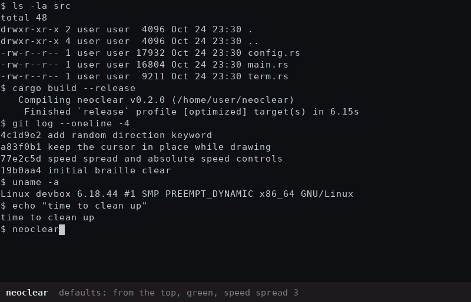

# neoclear

A `clear` replacement in the spirit of [pyroclear](https://crates.io/crates/pyroclear),
but instead of burning the screen down it pours in streams of braille glyphs (U+2800–U+28FF, like `neo --charset braille`), cmatrix-style. The streams eat whatever is on screen, meet in the middle, fade out with decreasing brightness, and leave a blank terminal (scrollback included) for your prompt.

Pure Rust standard library — **no dependencies**. Terminal size, echo
suppression and Ctrl-C handling go through a few lines of libc.



The preview cycles through the defaults, `-d horizontal`, `-d vertical`, `-d all`,
`-s 1` / `-s 6`, `-c green` / `-c red` / `-c '#00aeff'`, `--trail 3` / `--trail 30`
and `--glitch 0` / `--glitch 0.3`. A smoother 60 fps version is in
[preview.mp4](preview.mp4).

## Build & install

```sh
cargo install --path .          # or: cargo build --release
alias clear=neoclear             # bash/zsh; fish: alias -s clear=neoclear
```

## Directions

Every cell is claimed by the closest enabled edge, the streams always finish on a meeting line:

| `-d`                         | meets at                                  |
|------------------------------|-------------------------------------------|
| `top` (default)              | the bottom edge — classic cmatrix sweep   |
| `bottom`, `left`, `right`    | the opposite edge                         |
| `vertical` (= `top+bottom`)  | the middle row                            |
| `horizontal` (= `left+right`)| the middle column                         |
| `all`                        | the centre (an X-shaped front)            |
| `top+left`, `tl`, `bottom,right`, … | the diagonal / any mix you like    |
| `random`                     | a different one of all 15 combinations every run |

Separators `+ , | /` and spaces all work, as does the letter form (`tblr`).

## Options

```
-d, --directions <LIST>  top, bottom, left, right in any combination | vertical | horizontal | all | random
-t, --duration <MS>      time until all streams reach the centre        [900]
-f, --fade <MS>          fade-out after they meet                       [350]
    --fade-steps <N>     brightness steps in the fade                   [10]
    --fps <N>                                                           [60]
-c, --color <COLOR>      stream colour: #rrggbb, #rgb or a name         [#1cff5a]
                         (green red blue cyan magenta yellow amber orange purple pink white)
    --head-color <HEX>   leading glyph colour, or auto (tint of --color) [auto]
    --trail <CELLS>      bright trail length                            [10]
    --rest <0..1>        brightness behind the trail                    [0.45]
-s, --speed-spread <X>   fastest/slowest stream speed ratio, 1 = equal  [3]
    --speed <ROWS/S>     absolute speed of the slowest streams;
                         0 = fit everything into --duration             [0]
    --stagger <0..1>     how long fast streams may wait to start        [0.9]
    --glitch <0..1>      per-frame flicker chance of a settled glyph    [0.02]
    --chars <RANGE>      code points, hex (or d10240-10495 for decimal) [2800-28FF]
    --colormode <MODE>   auto | truecolor | 256                         [auto]
    --keep-scrollback    don't erase scrollback (default: erase, like clear)
    --size <COLSxROWS>   override size; also forces the animation when piped
    --config <PATH> / --no-config / --print-config / --write-config / --config-path
```

## Config file

`$XDG_CONFIG_HOME/neoclear/config.toml` (usually `~/.config/neoclear/config.toml`). Command-line flags override it. Save your current flags as the new defaults with e.g.

```sh
neoclear -d all -c '#00b4ff' --write-config
```

```toml
directions = "top+bottom"      # or ["left", "right"], "all", ...
duration_ms = 900
fade_ms = 350
fade_steps = 10
fps = 60
color = "#1cff5a"                   # any #rrggbb
head_color = "auto"                 # or "#rrggbb"
trail = 10
rest = 0.45
speed = 0                       # rows/s of the slowest streams; 0 = use duration_ms
speed_spread = 3                # fastest stream = 3x the slowest
stagger = 0.9
glitch = 0.02
chars = "2800-28FF"
color_mode = "auto"
clear_scrollback = true
```

## Stream speeds

Every stream gets its own speed between the slowest and `speed_spread` × the
slowest (log-uniform), and faster streams get proportionally longer trails.
Fast streams start later, so very different speeds are on screen at the same
time while everything still meets on time — the cmatrix look. `-s 1` makes all
streams move as one sheet; 4–6 looks wilder.

By default the whole run fits into `duration_ms`, so a big terminal means fast
streams. Set `speed` (rows per second of the slowest streams) instead and the
streams keep the same pace on any terminal — a bigger window just takes longer,
like cmatrix. Horizontal streams move at twice that in columns, since cells are
about twice as tall as wide.

## Behaviour notes

- Draws over the current screen (no alternate screen), so the old content
  visibly disappears under the streams.
- Truecolour is used when `COLORTERM` (or a known terminal) says so, otherwise
  xterm-256; force either with `--colormode`.
- Output is diffed per cell and wrapped in synchronized-update markers, so
  terminals that support them (kitty, WezTerm, iTerm2, foot, …) get tear-free frames.
- The cursor stays put: every frame saves the cursor position, draws, and
  restores it inside the same synchronized update, so the terminal only ever
  renders it where it was. It moves exactly once, to the top-left, in the final
  clear — so cursor shaders/trails (e.g. Ghostty's) don't bounce around.
- Keystrokes during the animation aren't echoed; Ctrl-C, SIGTERM or resizing
  skips straight to the final clear and always restores cursor, wrap mode and echo.
- When stdout isn't a terminal it simply emits the clear sequence, like `clear`.

Tested and written for on Linux.

## License

neoclear is licensed under the GNU GPL v3 or later; see LICENSE.
